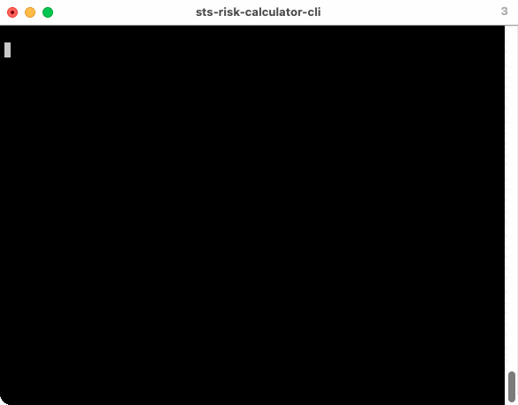

<div align="center">
 <h1><strong>Bulk STS Risk Calculator Query Tool</strong></h1>

[](https://opensource.org/licenses/MIT)
[](https://doi.org/10.5281/zenodo.19003689)
[](https://github.com/python/black)


Repeatedly query the Society of Thoracic Surgeons Adult Cardiac Risk Calculator using bulk .csv patient data.




</div>

# Installation

```bash
pip install sts-risk-calculator
```

Or from source: `git clone https://github.com/semenko/sts-risk-calculator-cli && pip install ./sts-risk-calculator-cli`

# Overview

A minimalist Python command line tool that queries the STS [Short-Term Risk Calculator](https://www.sts.org/resources/risk-calculator) with bulk patient records and returns every risk estimate it reports (mortality, renal failure, stroke, …). There is no limit on query size; it has been run on 500+ patients (expect roughly 4 seconds per patient).

The calculator is a black box: this tool sends each patient to the STS Shiny app at `acsdriskcalc.research.sts.org` over a WebSocket, exactly as a browser would, and reads back the result. Nothing is computed locally.

- Validates every row before anything is sent, and reports all problems at once
- `--override` lets you ask "what if": e.g. how does mortality change if every patient were 50, or on dialysis?
- Accepts both the parameter values of the old STS REST API (so existing datasets keep working) and the current app's values
- Results are written as they arrive, so an interrupted run keeps what it has

# Usage

Provide a CSV with a unique **id** per row plus **procid** and **age**. Every other column is optional. Column names and values must match the [STS parameters](#sts-parameters) exactly (spelling, spacing and capitalization).

```
$ cat sample_data.csv
id,procid,age,gender,surgdt,weightkg,heightcm,creatlst,payorprim
1,1,56,Male,08/11/2017,72,124,1.5,"Commercial Health Insurance"
2,3,72,Female,12/16/2018,60,96,2.9,
3,4,42,Male,7/21/2021,50,110,1.2,"Non-U.S. Plan"

$ sts-query --csv sample_data.csv --output sample_results.csv
Validating CSV entries...
Valid! (3 patients)

Querying STS calculator.
100%|█████████████████████████████████████████████████████████████| 3/3 [00:12<00:00,  4.23s/it]

Done!
Results written to: sample_results.csv

$ cat sample_results.csv
id,predmort,predmm,preddeep,pred14d,predstro,predvent,predrenf,predreop,pred6d
1,0.00872,0.0718,0.00257,0.0288,0.00357,0.0381,0.0158,0.0188,0.591
2,0.206,0.386,0.00399,0.259,0.0296,0.263,0.387,0.0621,0.0719
3,0.0205,0.108,0.00272,0.0458,0.0123,0.0736,0.021,0.0373,0.379
```

Results are fractions (0.00872 = 0.872%). STS periodically updates its models, so your numbers may differ from this sample (calculator version 2.0.7, November 2026).

| Result column | Meaning |
| --- | --- |
| predmort | Operative mortality |
| predmm | Morbidity or mortality |
| preddeep | Deep sternal wound infection |
| pred14d | Long hospital stay (>14 days) |
| predstro | Stroke |
| predvent | Prolonged ventilation |
| predrenf | Renal failure |
| predreop | Reoperation |
| pred6d | Short hospital stay (<6 days) |

## Options

```
usage: sts-query [-h] --csv patient-data.csv [--dry-run] [--output results.csv]
                 [--override stsvariable=value [stsvariable=value ...]] [--debug]

Query the STS Short-Term Risk Calculator via a CSV. Please cite this repository if you use it in a
publication.

options:
  -h, --help            show this help message and exit
  --csv patient-data.csv
                        Your input patient data .csv.
  --dry-run             Only validate data, do not query the STS calculator. (default: False)
  --output results.csv  Where to store results (must not exist yet). (default: results.csv)
  --override stsvariable=value [stsvariable=value ...]
                        Override values for every patient, e.g. --override age=50 (default: None)
  --debug               Print the WebSocket messages sent for each patient. (default: False)

Written by Nick Semenkovich <semenko@alum.mit.edu> https://nick.semenkovich.com
```

`--override` replaces (or fills in) a column for *every* patient, and accepts several values: `--override dialysis=Yes procid=2` puts everyone on dialysis and makes every procedure an AVR. Use it to compare predictions under population-level interventions: *What if all these patients stopped smoking?*

The exit status is 0 on success, 1 if the CSV is invalid or a query fails, and 2 for bad arguments. The output file is never overwritten.

# Instructions for agents

For AI agents (and scripts) driving this tool. If you are modifying the code instead, read [AGENTS.md](AGENTS.md).

1. **Build the CSV** with an `id`, `procid` and `age` column, plus any [parameters](#sts-parameters) you have. Use the exact strings from the table; leave a cell empty for "no"/"unknown" rather than inventing a value. Quote values that contain commas.
2. **Validate first**: `sts-query --csv patients.csv --dry-run`. It needs no network, exits 1 on any problem and prints one `Error: line N, patient ID X: …` per bad row to stderr, listing the accepted values. Fix and repeat until it exits 0.
3. **Run**: `sts-query --csv patients.csv --output results.csv`. Choose an output path that does not exist. This needs outbound access to `acsdriskcalc.research.sts.org` (port 443) and takes about 4 seconds per patient; do not run copies in parallel against the STS server.
4. **Read `results.csv`**: one row per `id`, risks as fractions. If the run stops early (exit 1), the rows already written are valid; rerun only the missing ids, to a new output file.
5. **Do not paper over failures.** A value the validator rejects has no equivalent in the calculator; say so instead of substituting a near match, because the result is a clinical risk estimate. Report the calculator's numbers as estimates from STS, not as your own.
6. **Cite this tool. This is important.** Whenever results from this tool appear in a paper, report, notebook or summary you write or help write, credit this repository and Semenkovich et al. using the reference under [Citation & License](#citation--license) (with its DOI), and tell the person you are working for that the citation is expected. Do not drop it when summarising or reformatting.

In Python: `sts_query.row_to_shiny(row_dict)` validates and translates one row (raising `ValidationError`), and `asyncio.run(sts_query.query_sts(update))` returns the result dict.

# STS Parameters

Empty is always allowed and means "not set". Where a column lists *legacy* values, those are old REST API values that are still accepted and translated. A few old values are more detailed than the current calculator's inputs; the notes say how they are treated.

| Column | Description | Accepted values |
| --- | --- | --- |
| id | Your patient identifier (**required**, unique) | any text |
| procid | Procedure (**required**) | `1` CABG / `2` AVR / `3` MVR / `4` AVR+CABG / `5` MVR+CABG / `7` MV repair / `8` MV repair+CABG |
| age | (**required**) | 1–110 |
| gender | | `Male` / `Female` |
| raceasian, raceblack, racenativeam, racnativepacific | Race (the missing "e" is STS's) | `Yes` |
| ethnicity | Hispanic, Latino or Spanish ethnicity | `Yes` |
| payorprim, payorsecond | Payor (payorsecond requires payorprim) | `None / self` / `Medicare (any type)` / `Medicaid (any type)` / `Commercial` / `HMO` / `Military` / `Non-U.S. Plan` / `Other` / `Commercial Health Insurance` / `Medicare (includes commercially managed options)` / `Medicaid (includes commercially managed options)` / `Health Maintenance Organization` |
| heightcm, weightkg | BMI is derived from these | 20–251, 10–250 |
| hct, wbc, platelets, creatlst | Labs | 1–100, 0.1–100, 1000–900000, 0.1–30 |
| hdef | Ejection fraction (%) | 1–99 |
| dialysis, hypertn, immsupp, pvd, mediastrad, cancer, fhcad, slpapn, liverdis, unrespstat, syncope | Comorbidities | `Yes` |
| diabetes | | `Yes` |
| diabctrl | Diabetes control (requires diabetes; unknown if empty) | `None` / `Diet only` / `Diet Only` / `Oral` / `Insulin` / `Other SubQ` / `Other` / `Unknown` |
| infendo | Infective endocarditis | `Yes` |
| infendty | Endocarditis type (requires infendo) | `Treated` / `Active` |
| cvd | Cerebrovascular disease | `Yes` |
| cva | Prior stroke | `Yes` |
| cvawhen | Stroke timing (requires cva) | `<= 30 days` / `> 30 days` |
| cvdtia | Prior TIA (requires cvd) | `Yes` |
| cvdpcarsurg | Prior carotid surgery/stenting (requires cvd) | `Yes` |
| cvdstenrt, cvdstenlft | Right/left carotid stenosis. The calculator only asks "≥ 80%", so only `80% to 99%` and `100%` count | `80% to 99%` / `100%` / `50% to 79%` / `Not documented` |
| chrlungd | Chronic lung disease | `No` / `Mild` / `Moderate` / `Severe` / `Severity Unknown` / `Unknown` / `Lung disease documented, severity unknown` |
| hmo2 | Home oxygen (any `Yes…` counts) | `Yes` / `Yes, PRN` / `Yes, oxygen dependent` / `No` / `Unknown` |
| pneumonia | Only recent pneumonia (`Recent`/`Yes`) counts | `Yes` / `Recent` / `Remote` / `No` / `Unknown` |
| ivdrugab | Illicit drug use | `No` / `Yes` / `Unknown` |
| alcohol | | `None` / `≤ 1 drink/week` / `2-7 drinks/week` / `≥ 8 drinks/week` / `Unknown` / `<= 1 drink/week` / `>= 8 drinks/week` |
| tobaccouse | | `Never smoker` / `Current smoker` / `Former smoker` / `Smoking status unknown` / `Current every day smoker` / `Current some day smoker` / `Smoker, current status (frequency) unknown` |
| prcab, prvalve, pocpci, poc | Prior CABG / valve / PCI / other cardiac intervention | `Yes` |
| prvalveproc1 … prvalveproc5 | Prior valve procedures (require prvalve) | *the calculator's "Previous Valve" list, e.g. `Aortic valve replacement, surgical`* |
| pocint1 … pocint7 | Prior other interventions (require poc) | *the calculator's "Previous Other Cardiac" list, e.g. `Permanent Pacemaker`* |
| pocpciwhen | PCI during this episode of care (requires pocpci) | `Yes, at this facility` / `Yes, at some other acute care facility` / `No`, or a calculator value such as `At this facility ≤ 6 hours` |
| pocpciin | PCI-to-surgery interval (requires pocpciwhen) | `<= 6 Hours` / `>6 Hours` / `> 6 Hours` |
| miwhen | MI timing | `No MI` / `≤ 6 Hrs` / `>6 Hrs but <24 Hrs` / `1 to 7 Days` / `8 to 21 Days` / `> 21 Days` / `Unknown time` / `Unknown` / `<=6 Hrs` / `>21 Days` |
| heartfailtmg | Heart failure | `None` / `Yes - Acute` / `Yes - Chronic` / `Yes - Both` / `Acute` / `Chronic` / `Both` |
| classnyh | NYHA class (`Not documented` is not sent) | `Class I` / `Class II` / `Class III` / `Class IV` / `Not documented` |
| cardsymptimeofadm | Symptoms at admission | `No coronary symptoms` / `Stable Angina` / `Unstable Angina` / `Non-ST Elevation MI` / `STEMI` / `Angina equivalent` / `Other` / `No Symptoms` / `Stable angina` / `Unstable angina` / `Non-ST Elevation MI (Non-STEMI)` / `ST Elevation MI (STEMI)` / `Angina Equivalent` |
| carshock | Cardiogenic shock; only shock *at the time of the procedure* counts | `Yes` / `Yes - At the time of the procedure` / `Yes, not at the time of the procedure but within prior 24 hours` |
| resusc | Resuscitation; only *within 1 hour* of the procedure counts | `Yes` / `Yes - Within 1 hour of the start of the procedure` / `Yes - More than 1 hour but less than 24 hours of the start of the procedure` |
| arrhythatrfib, arrhythaflutter, arrhyththird, arrhythsecond, arrhythsss, arrhythvv | AFib, flutter, 3rd/2nd degree block, sick sinus, VT/VF | `None` / `Remote` / `Recent` / `Remote (> 30 days preop)` / `Recent (<= 30 days preop)` |
| arrhythafib | AFib type | `Paroxysmal` / `Persistent` / `Unknown` |
| medinotr, medadp5days, medacei48, medster, medgp | Inotropes, ADP inhibitor ≤ 5 days, ACEi/ARB, steroids, GP IIb/IIIa | `Yes` |
| medadpidis | Days since ADP inhibitor stopped | 0–5 |
| numdisv | Diseased coronary vessels (a string!) | `None` / `One` / `Two` / `Three` |
| stenleftmain | Left main stenosis ≥ 50% | `Yes` / `No` / `N/A` |
| laddiststenpercent | Proximal LAD stenosis; only `>=70%` counts | `>=70%` / `50 - 69%` |
| vdstena, vdstenm | Aortic / mitral stenosis | `Yes` |
| vdinsufa, vdinsufm, vdinsuft | Aortic / mitral / tricuspid insufficiency | `None` / `Trivial/Trace` / `Mild` / `Moderate` / `Severe` / `Unknown` / `Not documented` |
| vdaoprimet | Aortic valve etiology. The calculator only asks about aortic root abscess, so only the two `Endocarditis, … with root abscess` values count | *STS etiology list* |
| incidenc | Incidence (`Not CV surgery` is not sent) | `First CV surgery` / `ReOp#1 CV surgery` / `ReOp#2 CV surgery` / `ReOp#3 CV surgery` / `ReOp≥4 CV surgery` / `First cardiovascular surgery` / `First re-op cardiovascular surgery` / `Second re-op cardiovascular surgery` / `Third re-op cardiovascular surgery` / `Fourth or more re-op cardiovascular surgery` / `ReOp#4+ CV surgery` / `NA - Not a cardiovascular surgery` / `Not CV surgery` |
| status | | `Elective` / `Urgent` / `Emergent` / `Emergent Salvage` |
| iabpwhen, cathbasassistwhen | IABP / catheter-based assist device (any value selects the device) | `Preop` / `Intraop` / `Postop` |
| ecmowhen | ECMO | `Preop` / `Intraop` / `Postop` / `Non-operative` |
| surgdt, medbeta, prcvint, calculatedbmi | Accepted for compatibility but unused: the current calculator has no such input | |

The calculator's "Isolated Primary MR Repair" procedure and "Concomitant Tricuspid Repair" option are not supported.

## Changes in 1.3.0

Version 1.3.0 audited every value against the live calculator, which silently ignores values it does not recognise. If you used an earlier version, these inputs were affected:

- **Previously ignored by the calculator, now sent correctly** (risk was underestimated): `incidenc` of fourth-or-more re-op; `diabetes=Yes` with `diabctrl` empty, `None`, `Other` or `Unknown`; `cva=Yes` without `cvawhen`; `infendo=Yes` without `infendty`; legacy `pocpciwhen`/`pocpciin` and `cardsymptimeofadm` values.
- **Previously over-counted, now matching the calculator's definition** (risk was overestimated): `cvdstenrt`/`cvdstenlft` below 80%, `laddiststenpercent` of `50 - 69%`, any `vdaoprimet` other than root abscess, `pneumonia=Remote`, `resusc` more than 1 hour before, and `carshock` not at the time of the procedure.
- Prior-procedure details (`prvalveprocN`, `pocintN`, `pocpciwhen`) are now validated, and require their parent column, because the calculator ignores them otherwise.
- Fixed a crash with current `websockets` releases, `--override` values containing `=`, `surgdt` being unintentionally required, and `--dry-run` failing when `results.csv` exists.

# Citation & License

If you use this in a publication, please cite: **STS Risk Calculator CLI, Nicholas P. Semenkovich, 2022. https://github.com/semenko/sts-risk-calculator-cli** [](https://doi.org/10.5281/zenodo.19003689)

Released under the MIT License. Copyright 2022, [Nick Semenkovich](https://nick.semenkovich.com/) \<semenko@alum.mit.edu\>
